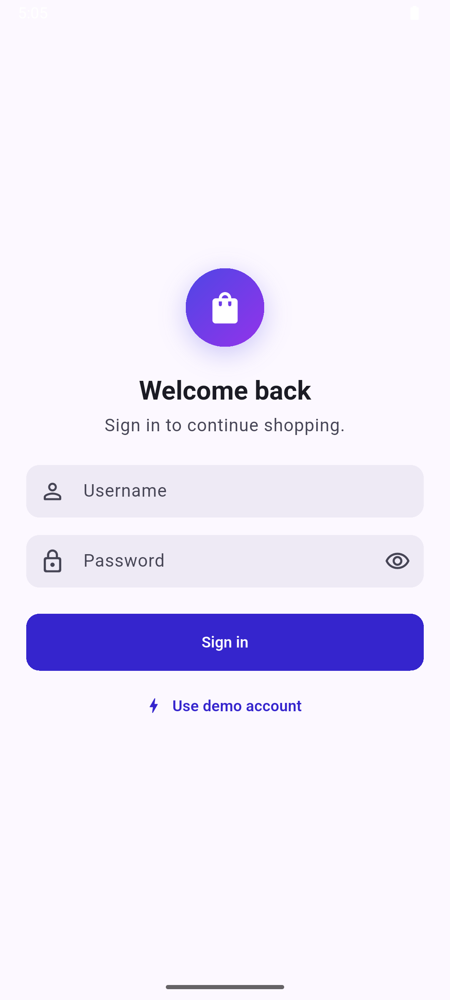
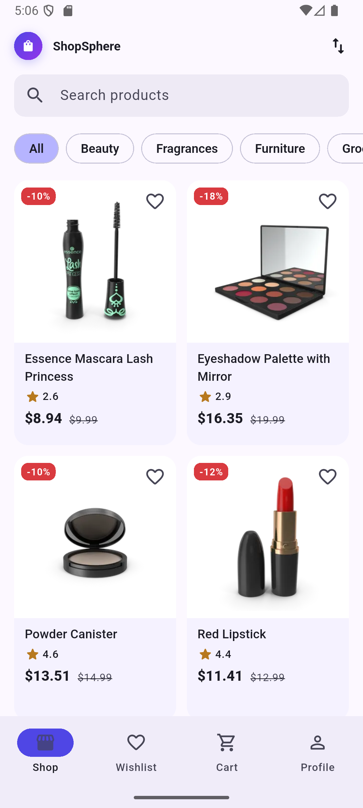
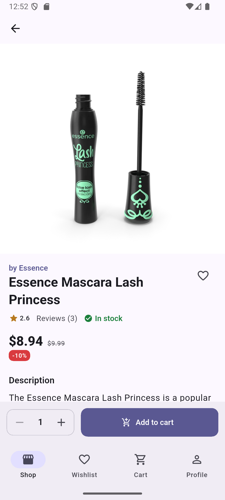
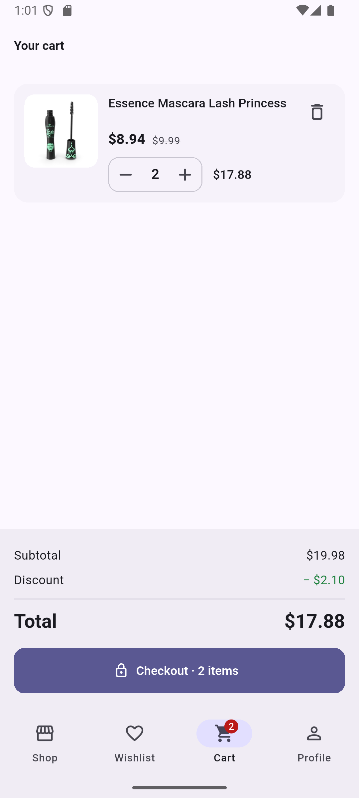
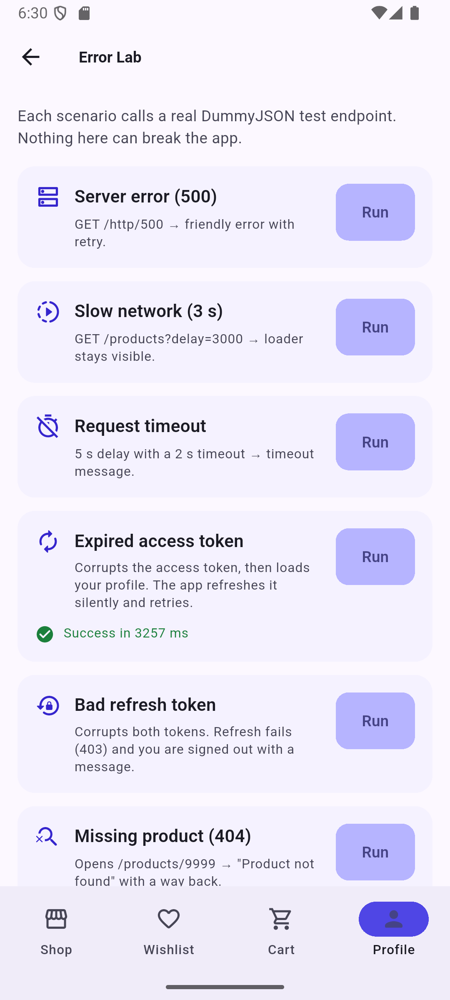
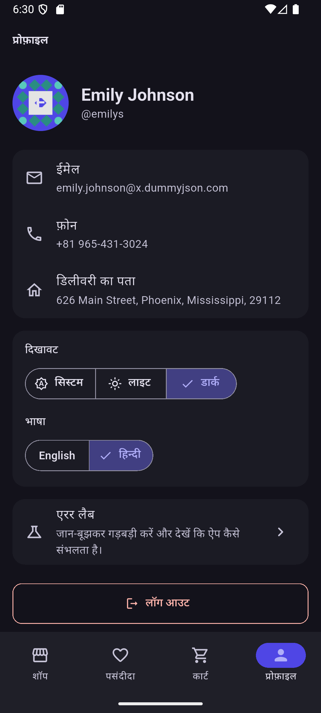
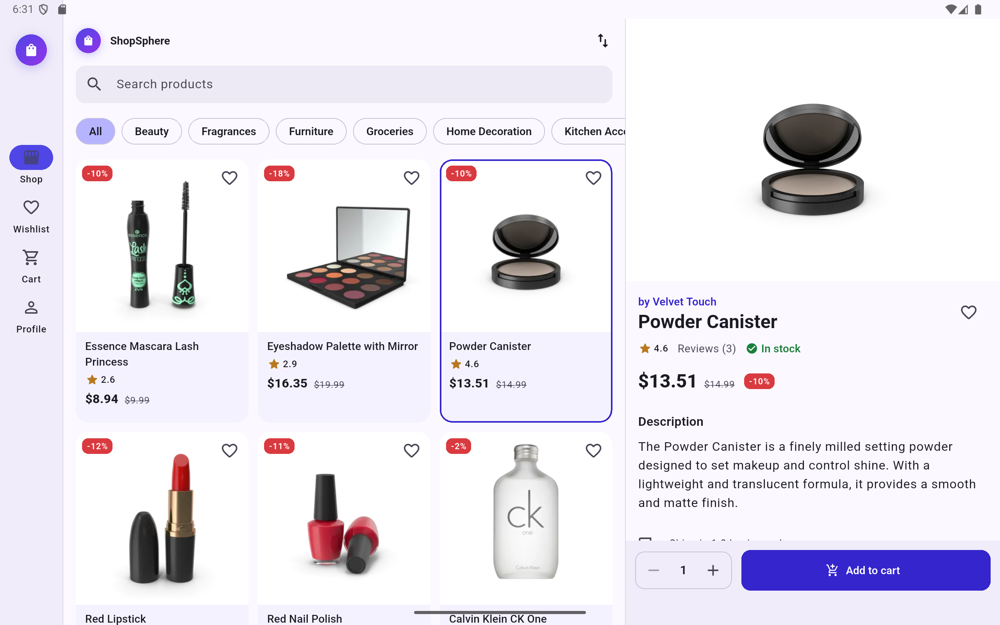
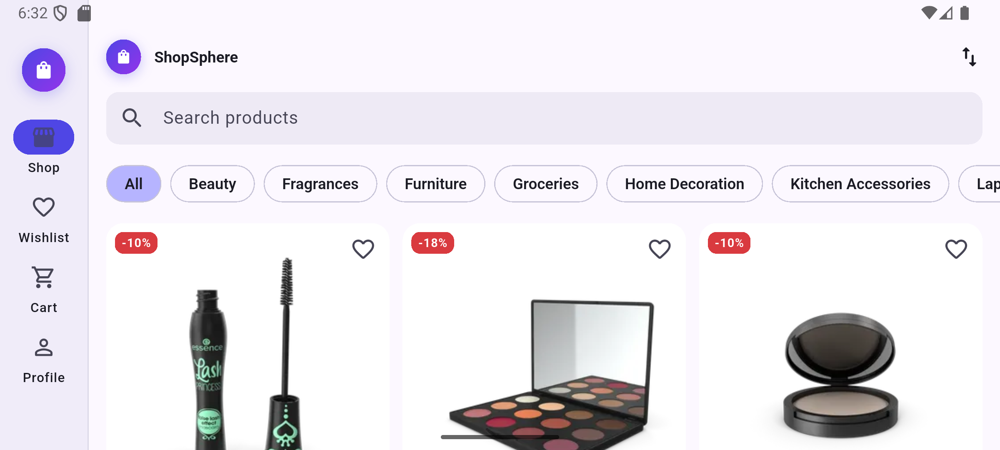

# ShopSphere

A calm, fast shopping catalogue for Android phones and tablets, built with Flutter on the
[DummyJSON](https://dummyjson.com) API. Sign in, browse and search products, read the details, fill a
cart that survives restarts, and place a (simulated) order. Every screen has designed loading, empty
and error states, and an in-app **Error Lab** triggers each API failure on demand so the error
handling can be seen, not just claimed.

| | |
|---|---|
| **APK** | [GitHub Release v1.0.0](../../releases/tag/v1.0.0) |
| **Demo video & screenshots** | Google Drive link in the submission email |
| **Test login** | `emilys` / `emilyspass` (or tap **Use demo account**) |

> Planning docs: [Product requirements](docs/PRD.md) · [System design](docs/SYSTEM_DESIGN.md)

---

## 1. Screenshots

| Login | Shop | Details | Cart |
|---|---|---|---|
|  |  |  |  |

| Error Lab | Profile (dark, हिन्दी) |
|---|---|
|  |  |

| Tablet landscape: master–detail | Phone landscape: navigation rail |
|---|---|
|  |  |

## 2. Features

### Must

- [x] Splash checks the stored session and routes to Shop or Login
- [x] Login with inline validation (empty, min length), password toggle, loading button
- [x] `POST /auth/login`; access + refresh tokens in `flutter_secure_storage`
- [x] Clear "Invalid username or password." for HTTP 400
- [x] Responsive product grid: thumbnail, title, price, discount, rating
- [x] Infinite scroll (`limit`/`skip`, 20 per page) with footer loader and end-of-list
- [x] Pull-to-refresh
- [x] Category chips from `/products/categories`
- [x] Search with 400 ms debounce (stale responses are cancelled)
- [x] Sort: price ↑ / ↓, rating, title
- [x] Shimmer skeletons on first load; "No products found" empty state
- [x] Details: image carousel with indicator, title, brand (null-safe), price + discount, rating,
      stock, description, reviews
- [x] Add to cart with quantity selector; disabled when out of stock
- [x] `/products/9999` shows "Product not found" with a way back
- [x] Cart: add / remove / change quantity; subtotal, discount and total
- [x] Cart persisted locally (survives restart)
- [x] Live cart badge on the navigation bar/rail
- [x] `POST /carts/add`, success screen, cart cleared
- [x] Profile from `GET /auth/me`: avatar, name, email, phone
- [x] Logout clears tokens and local session
- [x] 401 / failed refresh (403) signs the user out with an explanation

### Bonus

- [x] **Automatic token refresh**: `QueuedInterceptor` refreshes on 401 and retries the request
- [x] **Hero** animation from grid thumbnail to details
- [x] **Light / dark / system theme**, persisted
- [x] **Wishlist** stored locally
- [x] **Offline mode**: cached first page plus "You are offline" banner; auto-refresh when back online
- [x] **Localisation**: English + हिन्दी, switchable in Profile, persisted
- [x] **Widget tests and a golden test**, plus automated 1.3× font-scale overflow checks
- [x] **CI**: GitHub Actions runs format, analyze, tests with coverage, and builds the APK

### Extras (not in the brief)

- **Error Lab** (Profile → Error Lab): runs `/http/500`, 3 s delay, a timeout, an expired access token
  (silently refreshed) and a bad refresh token (forced logout), and opens `/products/9999`
- **Tablet master–detail** on wide screens, **undo** after removing a cart item, a **demo account**
  button, **haptics** on add to cart, and checkout with the delivery address from `/auth/me`

### Not done / known limitations

- No integration (device-driven) tests. Coverage comes from unit and widget tests.
- The router, app shell (bottom bar ↔ rail) and the DI wiring are verified by hand on the emulator,
  not by automated tests.
- Golden tests run locally only: font rendering differs between Windows and the Linux CI runner.

## 3. Tech stack

| | Version |
|---|---|
| Flutter | 3.47.7 (stable) |
| Dart | 3.13.5 |
| Android | minSdk = Flutter default (Android 8.0+ supported), targetSdk 36 |

| Package | Why |
|---|---|
| `flutter_bloc`, `bloc_concurrency`, `stream_transform` | State management; `droppable` for load-more, `debounce + restartable` for search |
| `equatable` | Value equality for states, entities and failures (cheap rebuild checks, simple tests) |
| `get_it` | Dependency injection without code generation |
| `dio` | One client with base URL, timeouts, interceptors (auth/refresh/logging) |
| `flutter_secure_storage` | Tokens in Android Keystore / iOS Keychain |
| `shared_preferences` | Cart, wishlist, settings and offline cache (all tiny JSON) |
| `go_router` | Declarative routes, auth redirect, `StatefulShellRoute` keeps each tab's state |
| `cached_network_image` | Disk-cached images with placeholders; thumbnails work offline |
| `shimmer` | Skeleton loaders |
| `connectivity_plus` | Drives the offline banner |
| `intl`, `flutter_localizations` | Currency/date formatting and gen-l10n (English + Hindi) |
| `bloc_test`, `mocktail` (dev) | State-sequence tests and mocks without code generation |
| `very_good_analysis` (dev) | Strict lint rules; `flutter analyze` reports 0 issues |

## 4. Architecture

Feature-first clean architecture: each feature has **presentation → domain ← data**. The domain layer
is pure Dart (no Flutter, Dio or storage imports).

```
┌──────────── Presentation ────────────┐
│ Pages/Widgets ─events─▶ Bloc/Cubit    │   no business logic in widgets
└──────────────────┬───────────────────┘
                   ▼ calls
┌────────────── Domain (pure Dart) ────┐
│ Use cases ─▶ Repository interfaces   │   entities, rules, sealed Failures
└──────────────────▲───────────────────┘
                   │ implements
┌────────────── Data ──────────────────┐
│ RepositoryImpl ─▶ Remote (ApiClient) │   typed models, fromJson/toJson
│                └▶ Local (prefs/secure)│
└──────────────────────────────────────┘
```

```
lib/
  main.dart                  # DI, session check, runApp
  app/                       # MaterialApp, router (auth redirect), responsive shell
  core/
    di/                      # get_it composition root
    network/                 # ApiClient, dio factory, AuthInterceptor, error mapper, endpoints
    error/  result/          # AppException → Failure, Result<T>, guard()
    storage/ session/        # secure tokens, key-value store, session-expired events
    connectivity/            # online/offline cubit
    theme/ l10n/ utils/      # Material 3 theme, ARB files, breakpoints, formatters
    widgets/                 # ErrorView, EmptyView, Skeleton, PriceText, QuantityStepper…
  features/
    auth/ products/ cart/ wishlist/ profile/ settings/ diagnostics/
      data/ domain/ presentation/
test/                        # mirrors lib/, plus fixtures/ (real API samples)
```

**One request end to end (load the next page):**

1. `ShopPage` scrolls near the end and adds `ProductsNextPageRequested`.
2. `ProductsBloc` (droppable, so a second scroll event is ignored) emits `pagination: loadingMore`.
3. `GetProducts` → `ProductRepository.getProducts(query, skip: 20)`.
4. `ProductRepositoryImpl` → `ProductRemoteDataSource` → `ApiClient.get('/products', {limit, skip, select, sortBy})`.
5. Dio answers JSON, or a `DioException` that `mapDioException` turns into an `AppException`.
6. The repository's `guard()` returns `Ok(ProductPage)` or `Err(Failure)`.
7. The bloc appends items and sets `reachedEnd` or `idle`, or `failed` (footer shows **Try again**).
8. `BlocBuilder` rebuilds the grid; old results are never overwritten thanks to a generation counter.

## 5. State management

**flutter_bloc** (mostly Cubits, one Bloc). States are explicit (`initial / loading / success / empty /
failure` plus a separate `idle / loadingMore / failed / reachedEnd` for pagination), so every screen
state is designed and testable with `bloc_test`. The product list is a full `Bloc` because event
transformers solve two real problems: search debouncing with cancellation (`restartable`) and
duplicate load-more events (`droppable`). The trade-off is more boilerplate than Riverpod, in exchange
for very predictable, traceable state changes.

## 6. Error handling

| Layer | Type | Example |
|---|---|---|
| HTTP | `DioException` | timeout, connection error, 404 |
| Data | `AppException` (thrown) | `NetworkException`, `RequestTimeoutException`, `ServerException(500)`, `NotFoundException`, `UnauthorizedException`, `BadRequestException`, `ParseException` |
| Domain | `Failure` (returned in `Result`) | `NetworkFailure`, `TimeoutFailure`, `ServerFailure`, `NotFoundFailure`, `InvalidCredentialsFailure`, `SessionExpiredFailure`, `UnexpectedFailure` |
| UI | Localised title + message + action | "You're offline. Check your connection and try again." + **Try again** |

- `mapDioException` is the only code that knows HTTP status codes; it is unit-tested.
- Repositories wrap work in `guard()`, so exceptions never reach the UI and bad JSON never crashes.
- **401 on a protected call**: the interceptor refreshes once and retries. **403 on refresh**: tokens
  are cleared, a session-expired event fires, and `AuthCubit` sends the user to Login with a message.
  A network error during refresh keeps the session and just reports "offline".
- Offline with a cached page: content stays, plus a banner. A refresh that fails while content is
  visible shows a snackbar instead of wiping the screen.

## 7. Getting started

Prerequisites: Flutter 3.47.x, Android SDK, an emulator or device (Android 8.0+).

```bash
git clone https://github.com/Hamzyzz-k/prosessed-flutter-assignment.git
cd prosessed-flutter-assignment
flutter pub get          # also generates localisations (flutter: generate: true)
flutter run
```

No code generation step is needed (models are hand-written, l10n is generated by `pub get`).

**Release APK**

```bash
flutter build apk --release
```

Without `android/key.properties` the release build is signed with debug keys, so anyone can build it.
To sign with your own key, create `android/key.properties` (git-ignored):

```properties
storeFile=C:/path/to/upload-keystore.jks
storePassword=…
keyAlias=upload
keyPassword=…
```

## 8. Testing

```bash
flutter test                         # all tests
flutter test --coverage              # writes coverage/lcov.info
flutter test --exclude-tags golden   # what CI runs
```

- **121 tests**, all passing: repositories (success, server failure, network failure, offline cache),
  use cases, every bloc/cubit (`bloc_test`), JSON parsing from real API fixtures, the auth interceptor
  against a fake HTTP adapter, widget tests for every screen except the app shell and router, a
  golden test, and **no-overflow tests at 1.3× font scale** on a 360 dp phone and in landscape.
- **Coverage**: 82.5% of lines in files the tests load (domain 96%, data 83%, presentation 87%).
  `flutter test --coverage` leaves out files no test imports (router, app shell, DI, `main.dart`);
  counting those as 0%, the whole-project figure is about 75%.

## 9. Test credentials

`emilys` / `emilyspass`. Any user from `GET /users` also works.

## 10. Assumptions & trade-offs

- **Logout clears the cart and wishlist** (they belong to that person on a shared device). A *forced*
  logout from an expired session keeps them, because the same person usually signs straight back in.
- **Search ignores category**: DummyJSON's search endpoint can't filter by category, so searching
  clears the chip and the UI says so.
- **Only the default first page is cached offline**: small, predictable, and it's what people see first.
- **Splash opens from the stored session immediately**, then validates it with `/auth/me` in the
  background, so the app opens instantly and still works offline.
- **SharedPreferences over Hive/Isar**: the data is tiny JSON; fewer moving parts.
- **Hand-written models over freezed**: no build step, and every line is easy to explain.

With more time: Hive/Isar for a larger offline catalogue, `patrol` integration tests on real devices,
flavours with `--dart-define`, crash reporting, and tests for the router and app shell.

## 11. Use of AI tools

I used **Claude Code** (Anthropic) as a pair programmer for scaffolding, boilerplate (models, tests,
ARB strings) and reviewing edge cases. Architecture decisions, the UX, and the trade-offs above are
mine. I ran, read and tested every line and can walk through any part of it.

## 12. Author

**Hamzah K** · khamzah0812@gmail.com · [github.com/Hamzyzz-k](https://github.com/Hamzyzz-k)
